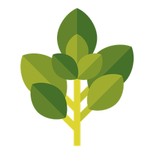
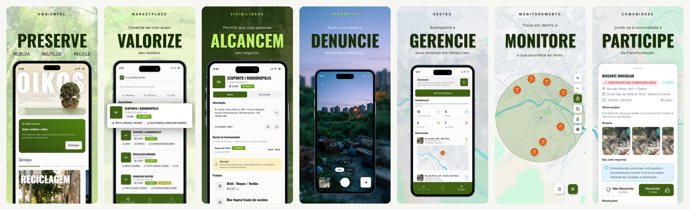
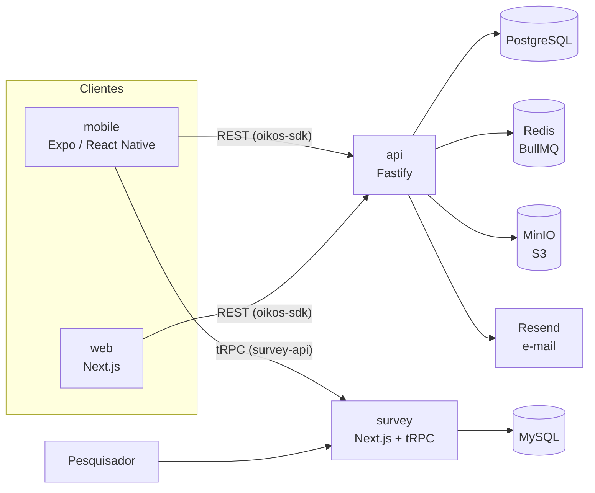
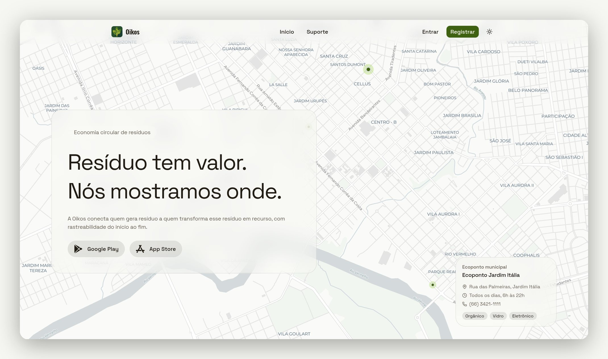
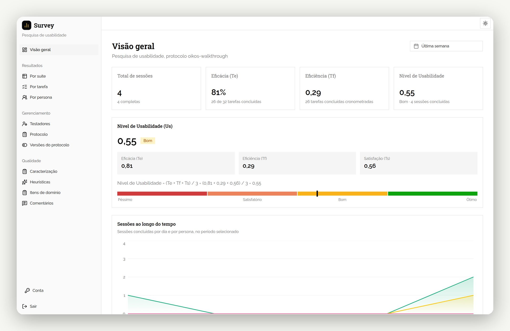
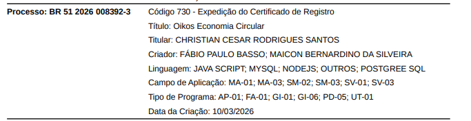

  

<h1 align="center">Oikos</h1>

  <strong>Resíduo tem valor. Nós mostramos onde.</strong> 
  Plataforma de economia circular de resíduos sólidos, feita no Brasil.

  <a href="https://oikos.company">oikos.company</a> ·
  <a href="https://apps.apple.com/br/app/oikos-economia-circular/id6786017565">App Store</a> ·
  <a href="https://play.google.com/store/apps/details?id=com.oikos">Google Play</a>

  <picture>
    <source media="(prefers-color-scheme: dark)" srcset="assets/mobile-screens-dark.jpg">
    
  </picture>

## O que é o Oikos

O Oikos conecta quem gera resíduo (moradores, empresas e órgãos públicos) a quem transforma esse resíduo em recurso: cooperativas, recicladoras, ecopontos e coletores. A ideia é tornar visível um mercado que já existe, mas que é difícil de encontrar, e dar à comunidade um jeito de cobrar o descarte correto.

- **Pontos de coleta e mercado.** Mapa de empresas e ecopontos com os resíduos que cada um aceita, horários de funcionamento e preço pago por quilo.
- **Denúncias ambientais.** Registro de descarte irregular com foto, vídeo e localização. A comunidade vota se a denúncia foi resolvida e a moderação acompanha o andamento.
- **Modo pesquisa.** Teste de usabilidade aplicado dentro do próprio aplicativo, usado na avaliação da dissertação de mestrado que originou o projeto.

## Repositórios

| Repositório | O que é | Stack principal |
|---|---|---|
| [**api**](https://github.com/oikos-circular-environment/api) | API REST, regras de negócio, autenticação, filas e armazenamento | Fastify, Prisma, PostgreSQL, Redis, MinIO |
| [**web**](https://github.com/oikos-circular-environment/web) | Site institucional e painel web para organizações e moderação | Next.js, Tailwind CSS, MapLibre |
| [**mobile**](https://github.com/oikos-circular-environment/mobile) | Aplicativo iOS e Android | Expo, React Native |
| [**survey**](https://github.com/oikos-circular-environment/survey) | Instrumento e painel do teste de usabilidade (ISO 9241-11) | Next.js, tRPC, Drizzle, MySQL |

Cada repositório tem no README como rodar localmente, a estrutura de pastas e a stack completa.

## Arquitetura

O app e o painel web consomem a API pelo mesmo SDK, gerado a partir da especificação OpenAPI. O survey é um sistema à parte, com banco e autenticação próprios, que recebe os dados do modo pesquisa do app.

<table>
  <tr>
    <td width="50%">
      <picture>
        <source media="(prefers-color-scheme: dark)" srcset="assets/web-hero-dark.jpg">
        
      </picture>
      
oikos.company

    </td>
    <td width="50%">
      <picture>
        <source media="(prefers-color-scheme: dark)" srcset="assets/survey-hero-dark.jpg">
        
      </picture>
      
Painel do survey, com dados fictícios

    </td>
  </tr>
</table>

## Pesquisa

O Oikos nasceu de uma pesquisa de mestrado. A plataforma foi concebida a partir de um estudo com atores da cadeia de resíduos, e a usabilidade do aplicativo é avaliada com um teste autoaplicado que mede eficácia, eficiência e satisfação, seguindo a ISO 9241-11 e o método de Lima, Oliveira e Santana (2013). O instrumento e o cálculo dos indicadores estão no repositório [survey](https://github.com/oikos-circular-environment/survey).

## Registro e licença

O Oikos Economia Circular é registrado no INPI como programa de computador, processo BR 51 2026 008392-3.

  

O código de todos os repositórios é disponibilizado sob a [PolyForm Noncommercial 1.0.0](https://polyformproject.org/licenses/noncommercial/1.0.0). Qualquer pessoa pode estudar, usar, modificar e redistribuir o Oikos para fins não comerciais: uso pessoal, pesquisa, ensino e uso por instituições de ensino, organizações beneficentes, de pesquisa ou de proteção ambiental e órgãos públicos.

Uso comercial, como vender o software, oferecê-lo como serviço pago ou usá-lo como base de um produto, exige uma licença comercial à parte com o titular. Para tratar disso, escreva para christian.cesar@oikos.company.

## Como colaborar

Contribuições são bem-vindas em qualquer repositório:

1. Abra uma issue descrevendo o problema ou a proposta.
2. Crie uma branch a partir de `development` com o nome `<número-da-issue>-<descrição-curta>`, ou trabalhe a partir de um fork.
3. Use [Conventional Commits](https://www.conventionalcommits.org/pt-br/) e abra o pull request para `development`.
